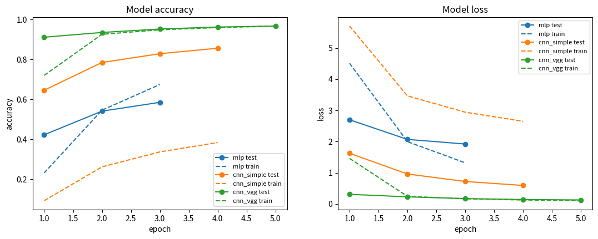
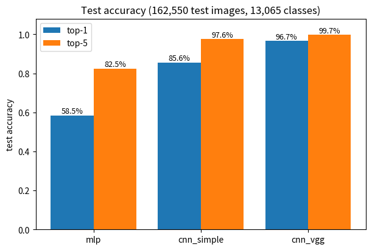
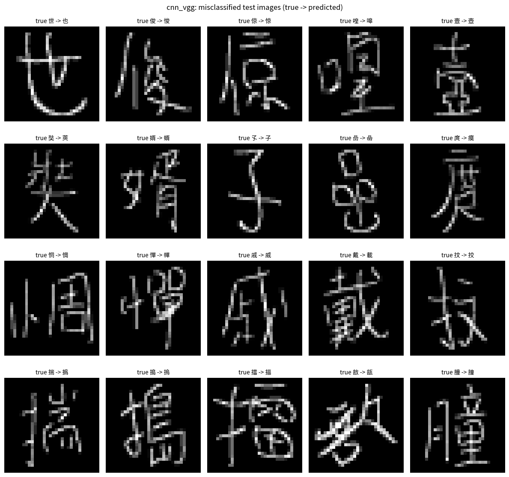

# DIT5411-John_Chu: Traditional Chinese Handwritten Character Recognition (13,065 classes)

Recognising 13,065 handwritten Traditional Chinese characters with TensorFlow/Keras, using OpenCV data augmentation and comparing three neural-network models (THEi DIT5411 Machine Learning assignment).

[](https://colab.research.google.com/github/John-ZCT/DIT5411-John_Chu/blob/main/notebooks/DIT5411_Colab.ipynb)

Everything is in one self-contained notebook, [`notebooks/DIT5411_Colab.ipynb`](notebooks/DIT5411_Colab.ipynb). It downloads the dataset, preprocesses it, augments the training set, trains the models and writes the results in `results/`. The run that produced the results below is saved with all its outputs in [`notebooks/DIT5411_Colab_executed.ipynb`](notebooks/DIT5411_Colab_executed.ipynb).

## Contents
1. [Dataset](#1-dataset)
2. [Preprocessing](#2-preprocessing)
3. [Data augmentation](#3-data-augmentation)
4. [Models](#4-models)
5. [Results](#5-results)
6. [Design choices](#6-design-choices)
7. [How to run](#7-how-to-run)
8. [Repository structure](#8-repository-structure)
9. [Course concepts used](#9-course-concepts-used)
10. [References](#10-references)

## 1. Dataset

**AI-FREE-Team Traditional Chinese Handwriting Dataset**, whole version (the `cleaned_data` set from [chenkenanalytic/handwritting_data_all](https://github.com/chenkenanalytic/handwritting_data_all)). The dataset was built from the STUST EECS Chinese MNIST dataset with the open-source Tegaki handwriting tools.

| Item | Value (counted by the notebook) |
|---|---|
| PNG images | 684,677 (300×300, dark strokes on white) |
| Characters (classes) | 13,065 |
| Samples per character | 16 to 61 (about 50 on average) |
| Training images (first 40 per character) | 522,127 |
| Test images (the rest) | 162,550 |
| Characters with 40 or fewer samples (no test samples) | 43 |

**Split rule (from the brief):** for each character, the samples are sorted by their number `n` (`<char>_<n>.png`, sorted as integers so `_2` comes before `_10`). The first 40 are training data and the rest are test data. The 43 characters with 40 or fewer samples put all their samples in the training set, so they have no test samples.

**Class index:** the 13,065 characters sorted by Unicode code point, numbered 0 to 13,064. The label is the text before the last `_` in the file name. File names are Big5 encoded, so the zip is read with `big5hkscs` decoding (plain `big5` fails on a few hundred names). Two folders have garbled labels in their file names (`p嶒` in folder 12332, whose images show 幕, and `濈u` in folder 2781). They are kept as they are, because each folder is its own class and the brief counts 13,065 classes.

**License:** the dataset is released under [CC BY-NC-SA 4.0](https://creativecommons.org/licenses/by-nc-sa/4.0/) by the AI-FREE-Team. It is derived from the STUST EECS Chinese MNIST dataset. This repository contains no dataset images, only code and small result figures.

## 2. Preprocessing

Each 300×300 PNG is read straight from the zip (no extraction) and turned into a 32×32 grayscale image (L11 thresholding and scaling):

1. Convert to grayscale (transparent pixels are composited onto white first).
2. Threshold with `cv2.threshold(..., cv2.THRESH_BINARY_INV)` (pixels darker than 225 are strokes) to find the strokes.
3. Invert, so strokes are white (255) on a black (0) background, like MNIST.
4. Crop to the bounding box of the strokes.
5. Pad to a square, keeping the aspect ratio, with an 8% margin.
6. `cv2.resize(..., (32, 32), interpolation=cv2.INTER_AREA)`.


## 3. Data augmentation

Each character has only 40 training samples, so OpenCV augmentation (L11 geometric transformations, following [darshitajain/Introduction-to-OpenCV](https://github.com/darshitajain/Introduction-to-OpenCV)) creates new samples until **every character has 240 training images (40 originals + 200 augmented)**. A character with fewer than 40 originals gets more augmented copies of each original, so it also reaches 240.

Each augmented image combines random transformations:

| Transformation | OpenCV | Parameter (`AUG` dict in the notebook) |
|---|---|---|
| Rotation | `cv2.getRotationMatrix2D` + `cv2.warpAffine` | ±15° |
| Shearing | matrix `[[1, sh, 0], [0, 1, 0]]` | sh in ±0.25 |
| Scaling (uniform) | scale matrix | factor 0.85 to 1.10 |
| Scaling (non-uniform) | different x and y factors | ±5% extra on x and y separately |
| Translation | matrix `T = [[1, 0, tx], [0, 1, ty]]` | up to ±4% of the image size |
| Perspective (non-affine) | `cv2.getPerspectiveTransform` + `cv2.warpPerspective` | 20% of images, each corner moves up to ±6% |
| Thicker strokes | `cv2.dilate` with a 2×2 kernel | 30% of images |

Details:
* Scaling, shearing, rotation and translation (and perspective, when used) are **multiplied into one 3×3 matrix**, so each image is interpolated only once. Calling `warpAffine` four times in a row would blur a 32×32 character four times.
* `borderValue=0` keeps the background black.
* Only dilation is used. Erosion would wipe out 1-pixel strokes at 32×32.
* Each character uses its own seeded random generator, so the augmented set is reproducible.
* **The test set is never augmented.**

**Final training set:** 13,065 × 240 = **3,135,600 images** (about 3.2 GB as uint8). They are written in a seeded shuffled order to a memory-mapped `.npy` file on the Colab local disk and read batch by batch.


## 4. Models

All three models are `keras.Sequential` with input `(32, 32, 1)` and the same output layer, `Dense(13065, activation='softmax')`. The output layer alone has 6,702,345 parameters (512 × 13,065 weights + 13,065 biases).

| Model | Idea | Layers | Parameters |
|---|---|---|---:|
| `mlp` | L6 MNIST model, scaled up | Flatten → Dense(512, relu) → Dense(512, relu) → Dense(13065, softmax) | 7,489,801 |
| `cnn_simple` | L7 CNN | 3 × [Conv2D 3×3, `padding='same'`, relu (32 / 64 / 128 filters) → MaxPooling2D 2×2] → Flatten → Dense(512, relu) → Dropout(0.5) → Dense(13065, softmax) | 7,844,105 |
| `cnn_vgg` | deeper VGG style with BatchNorm (L5 "deep vs fat") | 3 stages × 2 × [Conv2D 3×3 same → BatchNormalization → ReLU] (32 / 64 / 128 filters), MaxPooling2D 2×2 after each stage → GlobalAveragePooling2D → Dense(512) → BatchNormalization → ReLU → Dropout(0.4) → Dense(13065, softmax) | 7,058,665 |

* **`mlp`** treats the image as 1,024 separate pixels. It has no notion of neighbouring pixels, so a stroke shifted by two pixels looks like a different input. It is the baseline.
* **`cnn_simple`** learns 3×3 filters that detect local stroke patterns anywhere in the image, and max pooling makes it tolerant of small shifts. Dropout(0.5) reduces overfitting in the large dense layer.
* **`cnn_vgg`** is deeper: two 3×3 convolutions per stage see a 5×5 area with fewer parameters than one 5×5 filter. BatchNormalization keeps each layer's inputs well scaled, so the deeper network trains quickly. Global average pooling replaces the large Flatten → Dense layer.

Full layer tables: [`results/mlp_summary.txt`](results/mlp_summary.txt), [`results/cnn_simple_summary.txt`](results/cnn_simple_summary.txt), [`results/cnn_vgg_summary.txt`](results/cnn_vgg_summary.txt) (written by `model.summary()` in the Colab run).

**Training setup (same for all models):** `sparse_categorical_crossentropy` loss (the L4 softmax cross-entropy, with integer labels because one-hot labels for 3.1 million × 13,065 would not fit in memory), Adam with learning rate 0.001, batch size 1024, mixed precision (float16) on the GPU, inputs normalised with `x / 255.0`. Callbacks: `ModelCheckpoint` (keeps the best epoch), `EarlyStopping` (patience 2), `CSVLogger` and `BackupAndRestore`. Epochs: 3 for `mlp`, 4 for `cnn_simple`, 5 for `cnn_vgg`.

## 5. Results

<!-- RESULTS_START -->
All numbers come from one Google Colab run on a Tesla T4 GPU, with all 13,065 classes, 3,135,600 training images and 162,550 test images ([`results/summary.md`](results/summary.md), [`results/metrics_*.json`](results/)). The executed notebook with all outputs is [`notebooks/DIT5411_Colab_executed.ipynb`](notebooks/DIT5411_Colab_executed.ipynb). Its last cell shows a `NameError`: the cell had already run once and saved `results_32px.zip` to Google Drive, but the free Colab GPU quota then ran out, and running that cell again on the reset runtime (where all variables were gone) produced the error. The results here come from that saved zip.

| Model | Parameters | Epochs run (best) | Training time (T4) | Test top-1 | Test top-5 |
|---|---:|---:|---:|---:|---:|
| `mlp` | 7,489,801 | 3 (3) | 3.3 min | 58.47% | 82.48% |
| `cnn_simple` | 7,844,105 | 4 (4) | 11.6 min | 85.56% | 97.58% |
| **`cnn_vgg`** | **7,058,665** | **5 (5)** | **30.8 min** | **96.65%** | **99.73%** |

**Best model: `cnn_vgg`**, with **96.65% top-1** and **99.73% top-5** accuracy on the 162,550 test images (test loss 0.130).

Test top-1 accuracy after each epoch (from [`results/logs/`](results/logs/)):

| Model | Epoch 1 | Epoch 2 | Epoch 3 | Epoch 4 | Epoch 5 |
|---|---:|---:|---:|---:|---:|
| `mlp` | 42.22% | 54.05% | 58.47% | | |
| `cnn_simple` | 64.53% | 78.43% | 82.80% | 85.56% | |
| `cnn_vgg` | 91.06% | 93.45% | 95.16% | 96.17% | 96.65% |





Misclassified test images of the best model (from a random sample of 2,048 test images; title = true → predicted):



More examples: [`misclassified_mlp.png`](results/misclassified_mlp.png), [`misclassified_cnn_simple.png`](results/misclassified_cnn_simple.png).

**Note:** the test set was used as the validation data during training (the brief picks the best model by its test accuracy). The reported test accuracy is therefore the accuracy of the best epoch on that same test set. In this run the best epoch was always the last epoch, so choosing the best epoch did not change which weights were evaluated.

### Discussion

* **Best model.** `cnn_vgg` is clearly the best on both measures: 96.65% top-1 and 99.73% top-5. Random guessing among 13,065 classes would score about 0.008%.
* **Top-1 vs top-5.** For the weaker models top-5 is much higher than top-1 (`mlp` 58.5% → 82.5%, `cnn_simple` 85.6% → 97.6%). When they are wrong, the correct character is usually among their next few guesses, so most mistakes are between similar-looking characters. `cnn_vgg` misses the top 5 for only 0.27% of the test images. Its misclassified examples are mostly characters that differ in one small part or stroke, for example 戚 → 威 and 孑 → 子.
* **MLP vs CNN.** The three models have a similar number of parameters (7.1 to 7.8 million, of which 6.7 million are in the shared output layer), but the CNNs are far more accurate. The MLP sees 1,024 independent pixels, so the same stroke moved by a pixel or two is a new input. Convolution reuses the same 3×3 filters at every position, and pooling tolerates small shifts. This matches the variation in handwriting and in the augmented images (rotation, shear, scaling, translation).
* **Depth and BatchNorm.** `cnn_vgg` has the fewest parameters but is 11 points better than `cnn_simple`. It has six convolution layers instead of three, BatchNormalization after each, and global average pooling instead of a 1-million-parameter Flatten → Dense layer. BatchNorm makes the deep network train quickly: after its first epoch `cnn_vgg` already reached 91.1% test accuracy, more than `cnn_simple` after four epochs (85.6%). (`cnn_vgg` also trained one more epoch, but it was ahead from the first epoch.)
* **Overfitting (L5).**
  * `mlp`: training accuracy passes test accuracy in epoch 2, and the gap grows in epoch 3 (67.4% train vs 58.5% test; loss 1.32 vs 1.92). This is the start of overfitting: it memorises pixel patterns that do not generalise.
  * `cnn_simple`: training accuracy (38.3%) stays far below test accuracy (85.6%). This is not overfitting. Training accuracy is measured on the harder augmented images with Dropout(0.5) switched on, and averaged over an epoch in which the model is still improving. At test time dropout is off and the test images are not augmented. The model is still underfitting.
  * `cnn_vgg`: the training and test curves almost overlap (96.6% vs 96.7% in the last epoch), so there is no sign of overfitting.
  * `EarlyStopping` never stopped a model. Every model's best epoch was its last one, so all three were still improving when their epochs ran out.
* **Limits.**
  * 32×32 images blur thin strokes and merge small components, which causes many of the remaining look-alike errors.
  * Few epochs (3 / 4 / 5) were used because of the free Colab GPU quota (the quota was used up right after this run). Since no model had stopped improving, more epochs would probably raise all three accuracies, especially for `mlp` and `cnn_simple`.
  * The test set doubles as the validation set, so there is no fully independent test number. A separate validation split taken from the 40 training samples would fix this.
  * The 43 characters with 40 or fewer samples have no test images, so their accuracy is not measured.
<!-- RESULTS_END -->

## 6. Design choices

* **32×32 images.** The training set has 3,135,600 images. At 32×32 it is 3.2 GB as uint8, which fits on the free Colab local disk and trains in reasonable time on a free T4 GPU. At 64×64 it would be 12.8 GB, and each epoch would take about four times longer. Thin strokes of complex characters do get blurred at 32×32, which limits the accuracy.
* **Few epochs (3 / 4 / 5).** A free Colab session has limited GPU time. Each epoch already shows the model 3.1 million images, and `EarlyStopping` plus `ModelCheckpoint` keep the best epoch.
* **Augmentation done once, before training,** and stored on the local disk instead of on the fly, so the GPU is not waiting for the CPU (free Colab has only 2 CPU cores).
* **Google Drive only for small files** (prepared arrays about 0.2 GB, checkpoints, logs and results in `MyDrive/DIT5411_v2`), so the free 15 GB Drive is enough and a disconnected run can continue.
* **Integer labels and per-batch normalisation** avoid a 3.1 million × 13,065 one-hot matrix and 13 GB of float32 images.

## 7. How to run

1. Click the **Open in Colab** badge at the top.
2. Runtime → Change runtime type → **T4 GPU**.
3. Runtime → **Run all**, and allow access to Google Drive when asked.

The first run clones the dataset (about 1.2 GB), prepares it and caches the prepared arrays on Drive in `MyDrive/DIT5411_v2`, so later runs skip that step. It then builds the augmented training set, trains the three models and writes the figures and tables to `results/`. At the end it zips `results/` as `results_32px.zip`, saves a copy on Drive and downloads it. If the runtime disconnects, run all cells again: finished models are skipped, and an unfinished model continues from its last saved epoch.

Settings (image size, epochs, models, a quick 50-class test) are form fields in the first cell.

## 8. Repository structure

```
DIT5411-John_Chu/
├── README.md
├── requirements.txt          # packages (all already installed on Colab)
├── notebooks/
│   ├── build_notebook.py     # writes DIT5411_Colab.ipynb with nbformat
│   ├── DIT5411_Colab.ipynb   # the whole project: data, augmentation, models, training, results
│   └── DIT5411_Colab_executed.ipynb   # the same notebook with the outputs of the Colab run
└── results/                  # figures, metrics and logs from the Colab run
```

## 9. Course concepts used

| Step | Lecture | Used in the notebook |
|---|---|---|
| Show images | L7 Keras MNIST | `plt.subplot(330 + 1 + i)`, `plt.imshow(img, cmap=plt.get_cmap('gray'))` |
| Normalise | L7 | `x / 255.0` (per batch) |
| Preprocess | L11 thresholding, scaling | `cv2.threshold(..., cv2.THRESH_BINARY_INV)`, `cv2.resize(..., interpolation=cv2.INTER_AREA)` |
| Rotation, translation, scaling, shearing | L11 geometric transformations | `getRotationMatrix2D`, translation matrix `T`, shear matrix, `warpAffine` |
| Perspective | L11 affine vs non-affine | `getPerspectiveTransform` + `warpPerspective` |
| Models | L6 MNIST model, L7 CNN | `Sequential` with `Flatten`, `Dense`, `Conv2D`, `MaxPooling2D`, `Dropout`, `BatchNormalization` |
| Padding and pooling | Image classification lecture | 3×3 kernels with `padding='same'`, 2×2 max pooling with stride 2 |
| Loss and optimiser | L4 softmax cross-entropy, mini-batch, Adam | `sparse_categorical_crossentropy`, Adam |
| Overfitting | L5 | `Dropout`, `EarlyStopping` |
| Deep vs fat networks | L5 | `cnn_vgg` (deeper, narrow layers) vs `mlp` (wide dense layers) |
| Evaluate and predict | L7 steps 5–6 | `model.evaluate`, `model.predict`, `tf.argmax` |
| Curves | L7 Matplotlib | `plt.plot(history['accuracy'])` style curves from the CSV logs |

## 10. References

1. AI-FREE-Team, *Traditional Chinese Handwriting Dataset*. https://github.com/AI-FREE-Team/Traditional-Chinese-Handwriting-Dataset
2. chenkenanalytic, *handwritting_data_all* (whole-version data files). https://github.com/chenkenanalytic/handwritting_data_all
3. Tegaki, open-source handwriting recognition framework. https://github.com/tegaki/tegaki
4. STUST EECS (Southern Taiwan University of Science and Technology), *Chinese MNIST* handwriting dataset, the source of the AI-FREE-Team data.
5. darshitajain, *Introduction-to-OpenCV*. https://github.com/darshitajain/Introduction-to-OpenCV
6. TensorFlow / Keras documentation. https://www.tensorflow.org/api_docs and https://keras.io/api/
7. OpenCV documentation, geometric image transformations. https://docs.opencv.org/4.x/da/d6e/tutorial_py_geometric_transformations.html
8. kimanalytics, *Handwritten-Digit-Recognition-using-Keras-and-TensorFlow*. https://github.com/kimanalytics/Handwritten-Digit-Recognition-using-Keras-and-TensorFlow
9. THEi DIT5411 Machine Learning lecture notes (L4 to L7, L11).
